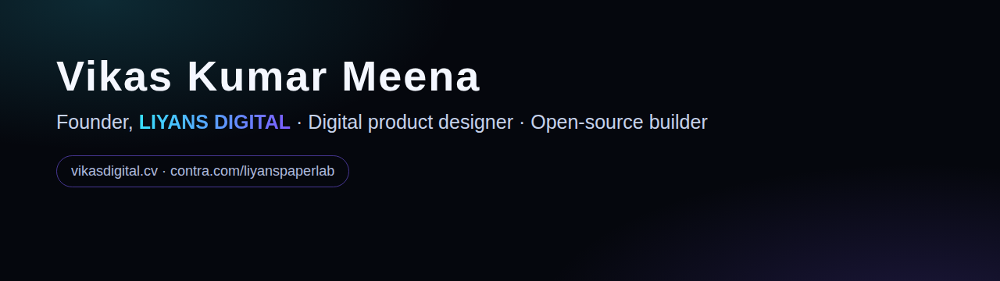

  

# Hi, I'm Vikas Kumar Meena

I design and build digital products — and I run **LIYANS DIGITAL**, a website
design studio. My work sits where design meets the web: interfaces, digital
products and open-source experiments that are built to be used, not just seen.

- 🌐 Website: [vikasdigital.cv](https://vikasdigital.cv)
- 💼 Services & portfolio: [contra.com/liyanspaperlab](https://contra.com/liyanspaperlab)
- 📍 Surajgarh, Rajasthan, India

## About me

- Founder of **LIYANS DIGITAL** — website design for businesses (WordPress and custom builds)
- Digital product designer behind **LiyansPaperLab** — printable planners and
  workbooks sold on Etsy and Payhip
- Builder of **LIYANS MCP**, a free, open (GPL) WordPress MCP plugin
- Also a Real Estate Specialist with Dholera Realty World, Dholera SIR, Gujarat

## Featured project — NEXORA

  

**NEXORA — Beyond the Frame** is a cinematic dark-glass skin for Video.js v10:
aurora-gradient timeline with storyboard previews, glass menus, full keyboard
support and reduced-motion care — entered in the Video.js Skins Design
Challenge by Mux.

- ▶ **Live demo:** https://nexora-beyond-the-frame.netlify.app/preview.html
- 📦 **Repository:** https://github.com/liyansdigital/nexora-beyond-the-frame

## Tools & technologies I work with

  
  
  
  
  
  
  

## What I'm focused on

- Premium, accessible web interfaces — design that survives real users and real devices
- Digital products that respect the buyer: honest previews, print-ready files
- Open source where it helps others build faster

## Contact

The fastest way to reach me is through
[Contra](https://contra.com/liyanspaperlab) or the contact page at
[vikasdigital.cv](https://vikasdigital.cv).
